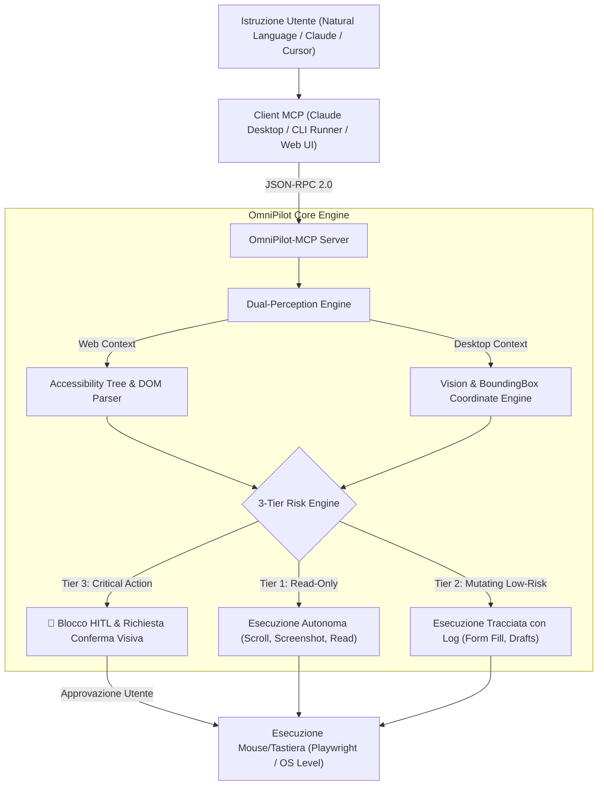
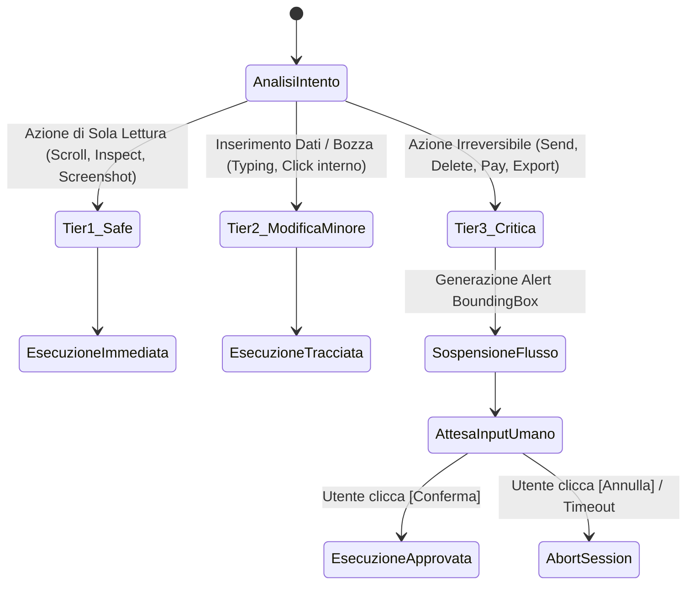

# 🚀 OmniPilot-MCP — Architectural Blueprint & Specification

**Repository:** `d:/omnipilot-mcp` (`@GabriMannino-pt/OmniPilot-MCP`)  
**Tagline:** *Autonomous Cross-Platform Executive Agent for Browser & Desktop Operations via Model Context Protocol*  
**Autore & Architetto:** Gabriele Mannino  
**Data di Progettazione:** 20 Ottobre 2026  

---

## 1. Executive Summary & Visione di Frontiera

Mentre il 95% del mercato italiano ed europeo si limita ancora a costruire wrapper di testo o semplici chatbot RAG, **OmniPilot-MCP** si posiziona sulla frontiera tecnologica più avanzata (guidata negli USA da *Anthropic Computer Use* e *Google Project Jarvis*): **Agenti di Computer-Use e Automazione GUI Cross-Platform**.

OmniPilot-MCP traduce istruzioni ad alto livello in linguaggio naturale (*"Genera la bozza d'ordine sul gestionale X, esporta la scheda in PDF e prepara l'email di invio"*) in una sequenza rigorosa di azioni visive e interazioni a schermo, implementando un'architettura **Dual-Perception (Vision + DOM)** e un motore di sicurezza deterministico **3-Tier Human-in-the-Loop (HITL)**.



---

## 2. Architettura Tecnica & Componenti

### 2.1 Stack Tecnologico Unificato (TypeScript / Node.js)
* **Runtime:** Node.js v20+ / TypeScript 5.5+ (Strict Mode).
* **Protocollo:** `@modelcontextprotocol/sdk` (Model Context Protocol JSON-RPC 2.0 standard `2024-11-05`).
* **Web Perception & Automation:** Playwright Chromium headless/headed con estrazione dinamica dell'albero di accessibilità ARIA (`accessibility.snapshot()`).
* **Desktop Perception & Automation:** 
  * Cattura schermo multi-monitor con compressione lossless WebP/PNG.
  * Mappatura coordinate XY e input simulato a livello di sistema operativo.
* **Validazione Dati:** Zod v3 per la validazione a runtime di tutti gli schemi JSON-RPC dei tool.
* **Web Dashboard:** React 19 + Vite + Tailwind CSS + WebSockets per lo streaming live del canvas e approvazione interattiva.

---

## 3. Catalogo Strumenti MCP (`tools/list`)

Il Server OmniPilot espone 6 tool standardizzati invocabili da qualsiasi client MCP:

| Tool MCP | Parametri Principali | Descrizione Tecnica |
| :--- | :--- | :--- |
| `omnipilot_take_screenshot` | `target: 'browser' \| 'desktop'`, `format: 'base64'` | Scatta uno screenshot istantaneo dello schermo o della scheda browser attiva e restituisce l'immagine con coordinate di riferimento. |
| `omnipilot_inspect_dom` | `selector?: string`, `includeAccessibility: boolean` | Estrae l'albero di accessibilità semantico del DOM (ruoli, etichette ARIA, coordinate bounding box degli elementi interattivi). |
| `omnipilot_click_element` | `selector: string`, `waitForNavigation?: boolean` | Esegue un click deterministico su un elemento del DOM garantendo il corretto trigger degli eventi JavaScript. |
| `omnipilot_click_coordinate` | `x: number`, `y: number`, `button: 'left' \| 'right'` | Muove il cursore virtuale alle coordinate XY ed esegue il click a livello OS/Canvas. |
| `omnipilot_type_text` | `text: string`, `pressEnter?: boolean`, `isSecret?: boolean` | Digita testo simulando la pressione di tasti umani o compilando direttamente input di form. |
| `omnipilot_request_approval` | `actionSummary: string`, `tier: 3`, `boundingBox: Rect` | **Guardrail HITL:** Sospende l'esecuzione, genera un frame con riquadro rosso sull'azione target e richiede conferma prima di procedere. |

---

## 4. Motore di Sicurezza a 3 Livelli (Tiered Risk Engine)

Per impedire danni accidentali (invio di email premature, pagamenti o cancellazioni dati), ogni azione pianificata viene classificata prima dell'esecuzione:



* **Tier 1 (Safe - Read Only):** Nessun impatto sullo stato del sistema. Esecuzione immediata a latenza zero.
* **Tier 2 (Low Risk):** Modifiche recuperabili (salvataggio bozze, compilazione campi). Esecuzione con log strutturato.
* **Tier 3 (Critical / Irreversible):** Azioni che inviano dati all'esterno o modificano record permanenti. L'agente blocca l'esecuzione e attende l'input umano.

---

## 5. Struttura del Repository (`d:/omnipilot-mcp`)

```text
d:/omnipilot-mcp/
├── .github/
│   └── workflows/
│       └── ci.yml               # Pipeline CI/CD: build TypeScript, linting, test E2E
├── docker/
│   ├── Dockerfile               # Multi-stage build isolata con headless Chromium
│   └── docker-compose.yml
├── src/
│   ├── mcp/
│   │   ├── mcpServer.ts         # Server JSON-RPC 2.0 conforme a spec 2024-11-05
│   │   ├── handlers/            # Tools, Resources, Prompts handlers
│   │   └── schemas.ts           # Contratti di validazione Zod
│   ├── perception/
│   │   ├── domEngine.ts         # Parser albero di accessibilità Playwright
│   │   ├── visionEngine.ts      # Screenshotting e coordinate mapper
│   │   └── dualPerception.ts    # Unificatore ibrido Vision + DOM
│   ├── execution/
│   │   ├── browserDriver.ts     # Wrapper controllato di Playwright
│   │   └── desktopDriver.ts     # Wrapper per azioni OS
│   ├── safety/
│   │   ├── riskEngine.ts        # Classificatore delle azioni (Tier 1/2/3)
│   │   └── approvalGate.ts      # Human-in-the-Loop event emitter
│   ├── cli.ts                   # E2E CLI Showcase runner
│   └── index.ts                 # Entrypoint server MCP
├── web-dashboard/               # Minimalist Control Dashboard (React + Vite)
│   ├── src/
│   └── package.json
├── tests/
│   ├── unit/                    # Test unitari Jest su Risk Engine e MCP Handlers
│   └── e2e/                     # Test E2E di navigazione autonoma e guardrail
├── package.json
├── tsconfig.json
└── README.md                    # Showcase con documentazione, GIF e benchmark
```

---

## 6. Piano di Implementazione & Phasing

1. **Fase 1 (Scaffolding & Core MCP):** Inizializzazione repository, setup TypeScript strict, SDK MCP e server JSON-RPC base.
2. **Fase 2 (Dual-Perception Engine):** Integrazione del driver Playwright con parser dell'albero di accessibilità e screenshot capture.
3. **Fase 3 (Tiered Risk Engine & HITL):** Implementazione del classificatore di rischio e del gatekeeper di approvazione per azioni Tier 3.
4. **Fase 4 (Showcase CLI & Test Suite):** Scenario dimostrativo completo riproducibile (estrazione report + bozza email con approvazione).
5. **Fase 5 (Web Control Dashboard):** Mini-interfaccia in React per il monitoraggio visivo in tempo reale.
6. **Fase 6 (README & GitHub Release):** Documentazione ad alto impatto per recruiter, CTO e post di annuncio LinkedIn.
