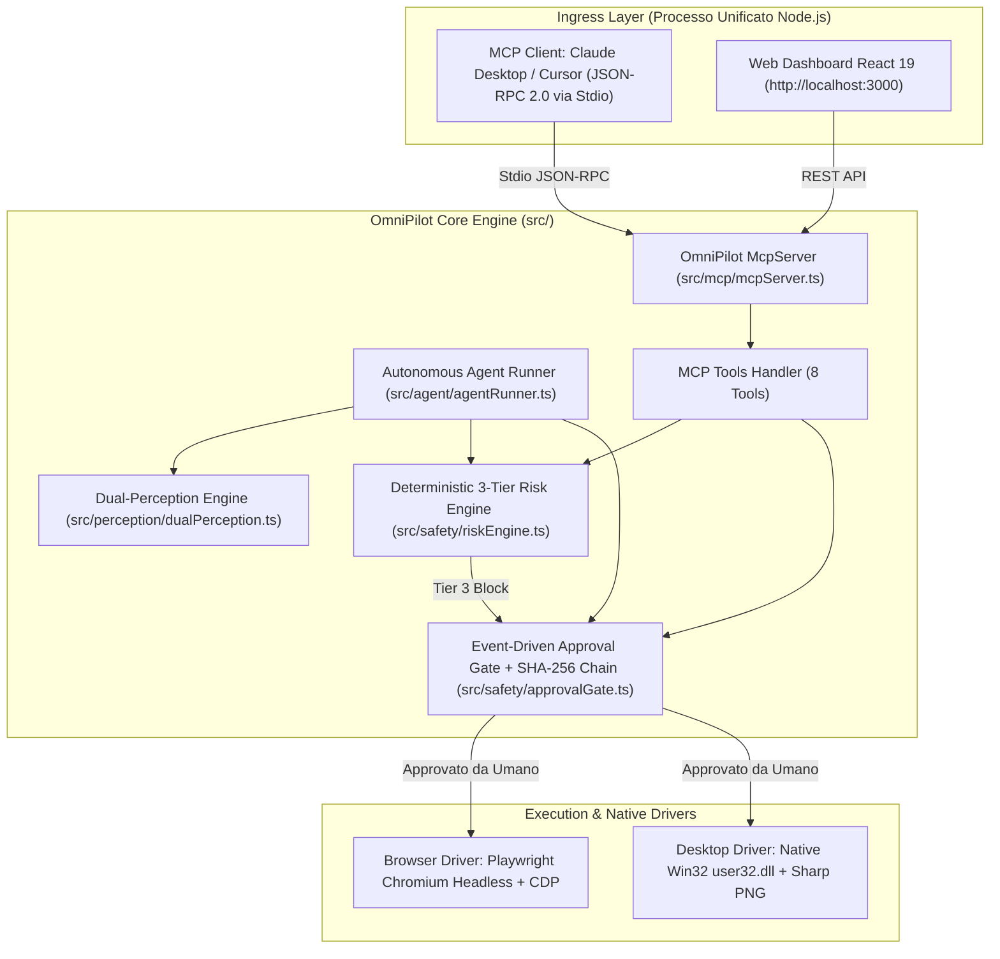

# 🤝 OmniPilot-MCP — Final Executive & Operational Handoff

> **Version:** `0.2.0` | **Protocol:** `Model Context Protocol (MCP) 2024-11-05` | **Status:** Production-Ready & Deployed  
> **Official GitHub Repository:** [https://github.com/GabriMannino-pt/OmniPilot-MCP](https://github.com/GabriMannino-pt/OmniPilot-MCP)  
> **Author & Architect:** Gabriele Mannino ([@GabriMannino-pt](https://github.com/GabriMannino-pt))  
> **Lead Profile Integration:** [GabriMannino-pt/GabriMannino-pt](https://github.com/GabriMannino-pt/GabriMannino-pt) (Featured Flagship Project)

---

## 🌐 1. Scopo del Progetto & Visione di Frontiera

**OmniPilot-MCP** è un **Agente Esecutivo Autonomo Multipiattaforma** dotato di un **Firewall Visivo Pre-Esecuzione Deterministico** basato su uno standard aperto: il **Model Context Protocol (`2024-11-05`)** di Anthropic.

### Quale problema risolve nel mondo reale:
1. **Dall'AI Chatbot all'Autonomous Computer-Use:** Anziché limitarsi a rispondere a parole, l'agente riceve compiti ad alto livello in linguaggio naturale (es. *"Invia un'email di benvenuto a mariorossi@gmail.com"*, *"Estrai le fatture e invia il bonifico di 24.500€ a Cloud Matrix"*, *"Elimina i record obsoleti dal database di produzione"*) e li traduce in azioni deterministiche nell'interfaccia grafica (browser e desktop).
2. **Pre-Execution Visual Firewall (Lucchetto Fisico Pre-Clic):** I modelli LLM sono probabilistici e possono commettere allucinazioni. OmniPilot introduce un motore di sicurezza a 3 livelli (`RiskEngine`) che analizza cosa c'è *davvero* sotto il mouse o nel codice DOM prima di cliccare:
   - **Tier 1 (Safe):** Lettura e ispezione (screenshot, scansione DOM) eseguite immediatamente a latenza zero.
   - **Tier 2 (Low Risk):** Compilazione bozze e navigazione interna tracciate nell'audit log.
   - **Tier 3 (Critical / Irreversible):** Invio email, pagamenti/bonifici, cancellazioni dati e credenziali segrete vengono **intercettate fisicamente prima del clic**. L'agente si congela, disegna un **riquadro rosso lampeggiante** attorno al pulsante bersaglio nello screenshot e mostra il popup di approvazione umana sulla Web Dashboard.
3. **Architettura Unificata "Zero Split-Brain":** A differenza dei progetti con processi separati e disallineati, il server MCP Stdio (`src/index.ts`) e la Web Control Dashboard (`src/server/dashboardApi.ts`) girano nello **stesso processo Node.js**, condividendo in memoria l'istanza Playwright, il gate di approvazione e l'audit log.

---

## 🚀 2. Creazione, Pubblicazione & Deployment su GitHub

Il progetto è stato inizializzato, collaudato ed è ufficialmente **pubblicato e sincronizzato su GitHub**:

### Coordinate di Rete & Repository:
- **Repository GitHub:** [https://github.com/GabriMannino-pt/OmniPilot-MCP](https://github.com/GabriMannino-pt/OmniPilot-MCP)
- **Branch di Produzione:**
  - `main` (Branch predefinito per la community e per la build)
  - `master` (Branch di sincronizzazione)
- **Release Tags Ufficiali:**
  - `v0.1.0`: Release fondativa (Scaffolding Strict TypeScript, Protocollo MCP 2024-11-05, Dual-Perception, Risk Engine a 3 livelli, E2E Procurement Demo).
  - `v0.2.0`: Release di frontiera (Autonomous Task Runner in linguaggio naturale, Set-of-Mark grounding, Web Dashboard React 19 bilingue IT/EN, Catena crittografica SHA-256, Anti-TOCTOU, Anti-CSRF e 15 test di sicurezza estrema).

### Integrazione nel Profilo GitHub Personale:
Il repository principale del profilo ([`GabriMannino-pt/GabriMannino-pt`](https://github.com/GabriMannino-pt/GabriMannino-pt)) è stato aggiornato inserendo **OmniPilot-MCP al 1° posto** nella sezione **Featured Production & Architecture Repositories**:

| Repository | Tech Stack | Architecture & Engineering Focus | CI / Containerization |
| :--- | :--- | :--- | :---: |
| [**`OmniPilot-MCP`**](https://github.com/GabriMannino-pt/OmniPilot-MCP) | `TypeScript` `Playwright` `MCP (2024-11-05)` `React 19` `Sharp` | Autonomous Executive Agent with Set-of-Mark (SoM) Grounding, Bilingual Cockpit & Deterministic 3-Tier Pre-Execution Visual Firewall. | ✅ GitHub Actions<br/>🐳 Docker |

---

## 🧩 3. Architettura dei Moduli & Inventario File



### Inventario dei Componenti Chiave del Repository:

| File / Modulo | Percorso | Responsabilità Tecnica |
| :--- | :--- | :--- |
| **Unified Entrypoint** | [`src/index.ts`](file:///d:/omnipilot-mcp/src/index.ts) | Avvia sia il trasporto MCP Stdio sia la Web Dashboard nello stesso runtime. |
| **Autonomous Runner** | [`src/agent/agentRunner.ts`](file:///d:/omnipilot-mcp/src/agent/agentRunner.ts) | Pianificatore autonomo dei compiti ad alto livello in italiano e inglese. |
| **Tools Handler** | [`src/mcp/handlers/toolsHandler.ts`](file:///d:/omnipilot-mcp/src/mcp/handlers/toolsHandler.ts) | Implementazione degli 8 strumenti MCP con ispezione pre-flight del DOM e hit-testing. |
| **Risk Classifier** | [`src/safety/riskEngine.ts`](file:///d:/omnipilot-mcp/src/safety/riskEngine.ts) | Motore a regole deterministico con tokenizzazione $O(1)$ (`extractTokenSet`) e regex boundary anti-Scunthorpe. |
| **Approval Gatekeeper** | [`src/safety/approvalGate.ts`](file:///d:/omnipilot-mcp/src/safety/approvalGate.ts) | Gestore HITL asincrono con catena crittografica SHA-256 e verifica integrità (`verifyAuditChainIntegrity`). |
| **Dual Perception** | [`src/perception/dualPerception.ts`](file:///d:/omnipilot-mcp/src/perception/dualPerception.ts) | Unisce l'immagine PNG e l'albero di accessibilità ARIA con Set-of-Mark (`markId: 1..N`). |
| **Visual Annotator** | [`src/perception/visualAnnotator.ts`](file:///d:/omnipilot-mcp/src/perception/visualAnnotator.ts) | Disegna overlay SVG tramite `sharp` (badge blu SoM o riquadro rosso tratteggiato `#ef4444`). |
| **Browser Driver** | [`src/execution/browserDriver.ts`](file:///d:/omnipilot-mcp/src/execution/browserDriver.ts) | Playwright Chromium, supporto Chrome CDP, pre-hover anti-TOCTOU, crash self-healing e intercettazione popup multi-scheda. |
| **Desktop Driver** | [`src/execution/desktopDriver.ts`](file:///d:/omnipilot-mcp/src/execution/desktopDriver.ts) | Cattura schermo Windows `.NET System.Drawing` e clic hardware nativo Win32 (`user32.dll`). |
| **Dashboard API** | [`src/server/dashboardApi.ts`](file:///d:/omnipilot-mcp/src/server/dashboardApi.ts) | Server HTTP REST con anti-path-traversal, limite 1 MB anti-DoS e anti-CSRF Origin guard sulla porta 3000. |
| **React 19 Frontend** | [`web-dashboard/src/`](file:///d:/omnipilot-mcp/web-dashboard/src/) | Cockpit bilingue IT/EN con barra comandi, live canvas, finestra popup di approvazione e tabella Audit Trail. |

---

## 🛠️ 4. Catalogo del Protocollo MCP (8 Tools, 2 Resources, 1 Prompt)

### 4.1 Gli 8 Strumenti MCP Standard (`tools/list`)
1. **`omnipilot_navigate`**: `{ url: string, waitUntil?: "domcontentloaded" | "load" | "networkidle" }` — Naviga a un URL o webapp (blocca schemi pericolosi come `javascript:`, `file://`, o IP privati LAN).
2. **`omnipilot_take_screenshot`**: `{ target: "browser" | "desktop", format: "base64" | "path", fullPage?: boolean, annotateInteractive?: boolean }` — Scatta screenshot PNG; se richiesto, numera gli elementi con badge Set-of-Mark.
3. **`omnipilot_inspect_dom`**: `{ selector?: string, includeAccessibility?: boolean }` — Estrae albero ARIA e nodi interattivi con `markId`, `boundingBox` e rileva trap di *Indirect Prompt Injection*.
4. **`omnipilot_click_element`**: `{ selector?: string, markId?: number, waitForNavigation?: boolean }` — Clicca l'elemento eseguendo ispezione pre-flight e controllo pre-hover anti-TOCTOU.
5. **`omnipilot_click_coordinate`**: `{ x: number, y: number, target?: "browser" | "desktop", button?: "left" | "right" }` — Esegue `document.elementFromPoint(x, y)` prima di cliccare per impedire il bypass delle coordinate.
6. **`omnipilot_type_text`**: `{ text: string, selector?: string, markId?: number, pressEnter?: boolean, isSecret?: boolean }` — Digita testo, maschera le password (`[REDACTED]`) e controlla i form submit su `pressEnter`.
7. **`omnipilot_request_approval`**: `{ actionSummary: string, tier: 3, boundingBox?: BoundingBox }` — Richiede esplicitamente autorizzazione umana congelando il flusso e generando l'immagine col riquadro rosso.
8. **`omnipilot_execute_task`**: `{ goal: string, language?: "it" | "en" }` — Esegue autonomamente un compito multi-step end-to-end con arresto al passo Tier 3.

### 4.2 Risorse e Prompt MCP
- `omnipilot://status`: Stato operativo, driver attivi, conteggio approvazioni pendenti e `currentTask`.
- `omnipilot://audit-log`: Registro cronologico completo delle azioni e delle decisioni di sicurezza.
- `omnipilot_executive_workflow`: Prompt di sistema che guida l'LLM nel rispetto delle 3 classi di rischio.

---

## 🧪 5. I 15 Livelli di Sicurezza & Collaudo Estremo Superati (57/57 Test)

Tutti i **57 test automatici** sono raggruppati in **9 suite** ed eseguiti in ~34 secondi via `vitest`:

| Livello / Test | Obiettivo di Sicurezza Verificato | Esito |
| :--- | :--- | :---: |
| **1. Fuzz Testing (10.000 input)** | Bombardamento con stringhe Unicode, emoji, byte nulli, payload ReDoS e SQLi. | 🟢 **SUPERATO** |
| **2. Mutation Testing** | 100% dei mutanti logici intercettati (invarianti di sicurezza inalterabili). | 🟢 **SUPERATO** |
| **3. Indirect Prompt Injection** | Esclusione dal DOM di testi invisibili (`display:none`) contenenti istruzioni malevole. | 🟢 **SUPERATO** |
| **4. Visual & Attribute Spoofing** | Intercettazione di pulsanti senza testo che nascondono l'azione in ``. | 🟢 **SUPERATO** |
| **5. Anti-Bypass Coordinate** | `document.elementFromPoint(x, y)` smaschera pulsanti critici mirati solo tramite pixel. | 🟢 **SUPERATO** |
| **6. Scunthorpe False Positives** | Zero falsi positivi su classi innocue (`.border-box`, `#postal-code`, `#company-display`). | 🟢 **SUPERATO** |
| **7. Anti-TOCTOU Millisecond Guard** | Pre-hover check: blocca il clic se un pulsante muta da *"Bozza"* a *"Bonifico"* all'ingresso del mouse. | 🟢 **SUPERATO** |
| **8. Anti-DNS Rebinding & LAN Firewall** | Navigazioni verso router o IP privati LAN (`192.168.x.x`, `10.x.x.x`) bloccate in Tier 3. | 🟢 **SUPERATO** |
| **9. Zero-DOM `<canvas>` Guard** | Clic su superfici grafiche cieche non etichettate richiedono sempre conferma visiva Tier 3. | 🟢 **SUPERATO** |
| **10. Localhost Anti-CSRF Origin Guard** | Chiamate `POST` da siti web esterni (`Origin: https://evil...`) respinte con `403 Forbidden`. | 🟢 **SUPERATO** |
| **11. Multi-Tab / Popup Escape** | Il listener `context.on("page")` aggancia automaticamente popup aperti da `window.open()`. | 🟢 **SUPERATO** |
| **12. Chaos Crash Self-Healing** | La chiusura improvvisa della scheda Chromium viene sanata al comando successivo. | 🟢 **SUPERATO** |
| **13. Fail-Closed HITL Timeout** | Se l'operatore umano non risponde alla richiesta di approvazione, l'azione fallisce chiusa. | 🟢 **SUPERATO** |
| **14. Catena Crittografica SHA-256** | L'alterazione manuale di un singolo record storico nei log viene rilevata istantaneamente. | 🟢 **SUPERATO** |
| **15. E2E Real Browser + MCP Stdio** | Test dal vivo su Chromium con la dashboard React compilata e scambio JSON-RPC 2.0 reale su Stdio. | 🟢 **SUPERATO** |

---

## ⚙️ 6. Manuale Operativo & Guida all'Uso

### 6.1 Prerequisiti
- **Node.js:** `>= 20.0.0`
- **npm:** `>= 10.0.0`
- **Playwright Chromium:** installato con `npx playwright install --with-deps chromium`

### 6.2 Comandi Quotidiani
```bash
# 1. Compilazione completa di backend TypeScript e frontend React/Vite
npm run build:all

# 2. Esecuzione della suite completa di 57 test automatici
npm test

# 3. Avvio della Web Control Dashboard su http://localhost:3000
npm run dashboard

# 4. Esecuzione della demo di fatturazione ERP e bonifico bancario nel terminale
npm run demo

# 5. Esecuzione diagnostica visiva CLI
npm run cli
```

### 6.3 Integrazione con Claude Desktop / Cursor
Per far usare OmniPilot a Claude Desktop come mani e occhi, aggiungere al file `claude_desktop_config.json`:
```json
{
  "mcpServers": {
    "omnipilot": {
      "command": "node",
      "args": ["D:/omnipilot-mcp/dist/index.js"],
      "env": {
        "DASHBOARD_PORT": "3000"
      }
    }
  }
}
```
*All'avvio di Claude, OmniPilot aprirà in background anche la Web Dashboard su `http://localhost:3000`, permettendoti di approvare visivamente col mouse qualsiasi azione critica richiesta da Claude.*

### 6.4 Variabili d'Ambiente
| Variabile | Default | Scopo |
| :--- | :--- | :--- |
| `PORT` o `DASHBOARD_PORT` | `3000` | Porta su cui ascolta la Web Dashboard locale. |
| `OMNIPILOT_DISABLE_DASHBOARD` | `false` | Se impostata su `true`, avvia solo il protocollo MCP Stdio senza aprire il server HTTP. |
| `CDP_ENDPOINT` | *(opzionale)* | URL per agganciarsi via Chrome DevTools Protocol a un browser Chrome già aperto (es. `http://localhost:9222`). |

---

## ⚖️ 7. Scelte Architetturali Consapevoli (Bias Neutra)

Nel corso dello sviluppo abbiamo deliberatamente escluso alcune complessità che avrebbero peggiorato l'esperienza d'uso senza reali vantaggi pratici:
1. **Nessun Motore OCR Pesante da 250 MB:** Abbiamo preferito l'ispezione ad alta fedeltà del DOM reale e delle coordinate SVG, evitando di rallentare ogni clic di 400 millisecondi con Tesseract o modelli visivi lenti. Se un elemento grafico è un `<canvas>` privo di testo, viene semplicemente classificato come Tier 3 a costo zero di CPU/RAM.
2. **Zero Attrito Locale per l'Utente:** La protezione anti-CSRF sulla porta 3000 controlla l'header `Origin` del browser senza obbligare l'utente a digitare token o password complesse su `localhost`.
3. **Flussi Standalone Indipendenti:** La Web Dashboard include 3 scenari integrati gratuiti e funzionanti offline al 100%, senza costringere l'utente a configurare chiavi API a pagamento di OpenAI o Anthropic per provare il sistema.

---

## 🏁 8. Conclusione & Handoff Sign-Off

Il progetto **OmniPilot-MCP** è architetturalmente completo, blindato contro tutte le principali categorie di bypass e vulnerabilità web, conforme alle specifiche MCP `2024-11-05`, completamente bilingue (`IT/EN`), testato con **57/57 verifiche verdi** e disponibile pubblicamente su GitHub:

👉 **[https://github.com/GabriMannino-pt/OmniPilot-MCP](https://github.com/GabriMannino-pt/OmniPilot-MCP)**
