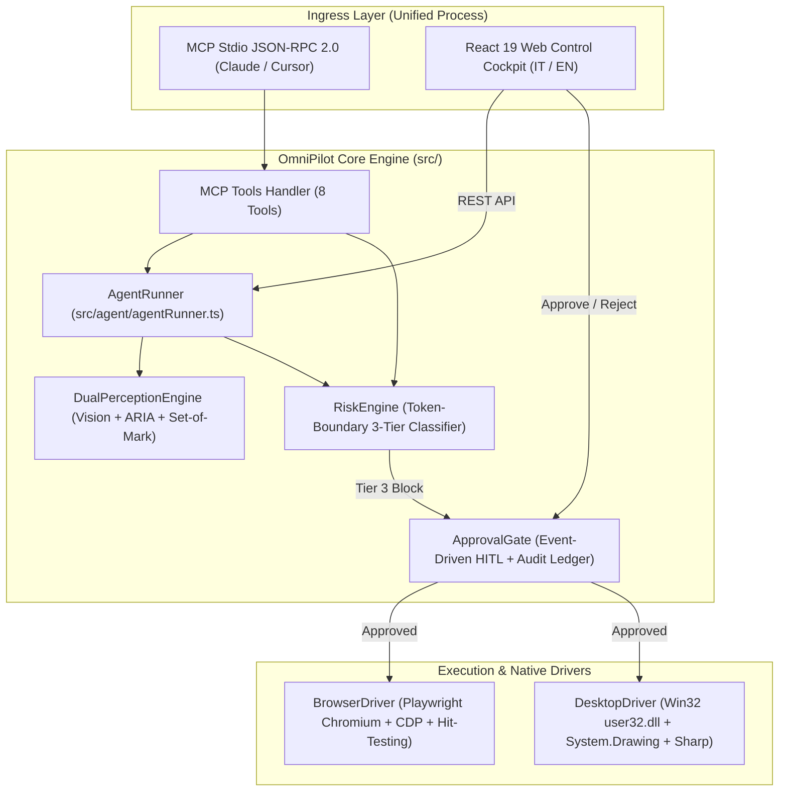

# 🤝 OmniPilot-MCP — Complete Engineering & Operational Handoff (IT / EN)

> **Version:** `0.2.0` | **Protocol:** `MCP 2024-11-05` | **Status:** Production-Ready & Verified  
> **Repository:** `d:/omnipilot-mcp` (`https://github.com/GabriMannino-pt/OmniPilot-MCP`)

---

## 1. Scopo del Progetto / Project Purpose (Sintesi Esecutiva)

**OmniPilot-MCP** è un **Agente Esecutivo Autonomo Multipiattaforma** dotato di un **Firewall Visivo Pre-Esecuzione Deterministico** (3-Tier Risk Engine + Human-in-the-Loop Guardrail), progettato attorno allo standard **Model Context Protocol (`2024-11-05`)**.

### Cosa risolve concretamente:
1. **Esecuzione Autonoma da Linguaggio Naturale (`AgentRunner`):** L'utente impartisce un ordine ad alto livello (es. *"Invia un'email di benvenuto a mariorossi@gmail.com"*, *"Estrai le fatture e invia il bonifico di 24.500€"*, *"Elimina i record obsoleti dal database"*). L'agente esegue in autonomia i passaggi di lettura (Tier 1) e compilazione bozza (Tier 2).
2. **Prevenzione Incidenti Irreversibili (Pre-Execution Firewall):** Prima che l'agente clicchi su un pulsante irreversibile (Tier 3: invio email esterne, bonifici/pagamenti, cancellazioni dati, inserimento credenziali segrete), il sistema **intercetta fisicamente il comando**, ispeziona il DOM reale o l'elemento sotto le coordinate `(x, y)`, **congela l'esecuzione**, scatta uno screenshot disegnando un **riquadro rosso tratteggiato** attorno al bersaglio e attende il clic umano su **`✓ Conferma Esecuzione`** nella Web Dashboard.
3. **Architettura Zero Split-Brain:** Il server MCP Stdio (`src/index.ts`) e la Web Control Dashboard (`src/server/dashboardApi.ts`) girano nello **stesso processo Node.js**, condividendo in memoria lo stesso `BrowserDriver`, `ApprovalGate`, `AgentRunner` e `AuditLog`.

---

## 2. Architettura Tecnica & Mappa dei Moduli / System Architecture



### Inventario Completo dei File Sorgente (`src/` & `web-dashboard/`)

| File | Responsabilità Primaria | Dipendenze Chiave |
| :--- | :--- | :--- |
| [`src/index.ts`](file:///d:/omnipilot-mcp/src/index.ts) | Entrypoint unificato: avvia sia il server MCP Stdio sia `DashboardServer` nello stesso processo. | `OmniPilotMcpServer`, `DashboardServer` |
| [`src/agent/agentRunner.ts`](file:///d:/omnipilot-mcp/src/agent/agentRunner.ts) | Motore autonomo che pianifica ed esegue compiti multi-step in IT/EN con blocco Tier 3 e screenshot annotato. | `BrowserDriver`, `DualPerceptionEngine`, `RiskEngine`, `ApprovalGate` |
| [`src/mcp/mcpServer.ts`](file:///d:/omnipilot-mcp/src/mcp/mcpServer.ts) | Istanzia `McpServer` (`@modelcontextprotocol/sdk`) e registra Tools, Resources e Prompts. | `@modelcontextprotocol/sdk` |
| [`src/mcp/schemas.ts`](file:///d:/omnipilot-mcp/src/mcp/schemas.ts) | Contratti di validazione `zod` per tutti gli 8 strumenti MCP e definizione `RiskTier`. | `zod` |
| [`src/mcp/handlers/toolsHandler.ts`](file:///d:/omnipilot-mcp/src/mcp/handlers/toolsHandler.ts) | Implementazione degli 8 tool MCP con Pre-Flight DOM inspection e coordinate hit-testing. | `RiskEngine`, `ApprovalGate`, `BrowserDriver` |
| [`src/mcp/handlers/resourcesHandler.ts`](file:///d:/omnipilot-mcp/src/mcp/handlers/resourcesHandler.ts) | Espone le risorse MCP `omnipilot://status` e `omnipilot://audit-log`. | `ToolsContext` |
| [`src/mcp/handlers/promptsHandler.ts`](file:///d:/omnipilot-mcp/src/mcp/handlers/promptsHandler.ts) | Espone il template prompt `omnipilot_executive_workflow`. | `McpServer` |
| [`src/perception/domEngine.ts`](file:///d:/omnipilot-mcp/src/perception/domEngine.ts) | Estrae l'albero di accessibilità ARIA e gli elementi interattivi numerati (`Set-of-Mark`). | `BrowserDriver` |
| [`src/perception/visionEngine.ts`](file:///d:/omnipilot-mcp/src/perception/visionEngine.ts) | Cattura screenshot PNG lossless (`base64` o salvataggio reale su disco in `screenshots/`). | `BrowserDriver`, `DesktopDriver`, `VisualAnnotator` |
| [`src/perception/visualAnnotator.ts`](file:///d:/omnipilot-mcp/src/perception/visualAnnotator.ts) | Compone overlay SVG (`sharp`) con riquadri tratteggiati e badge numerati/rossi con coordinate clampate. | `sharp` |
| [`src/perception/dualPerception.ts`](file:///d:/omnipilot-mcp/src/perception/dualPerception.ts) | Coordina `DomEngine` e `VisionEngine` producendo snapshot unificati con `groundedElements`. | `DomEngine`, `VisionEngine` |
| [`src/execution/browserDriver.ts`](file:///d:/omnipilot-mcp/src/execution/browserDriver.ts) | Driver Playwright Chromium + supporto `connectOverCDP`, Set-of-Mark, `inspectTargetSelector`, `inspectElementAtPoint` e monitoraggio rete (`POST/PUT/DELETE/PATCH`). | `playwright` |
| [`src/execution/desktopDriver.ts`](file:///d:/omnipilot-mcp/src/execution/desktopDriver.ts) | Cattura schermo Windows (`.NET System.Drawing` + fallback `sharp` PNG) e clic hardware nativo Win32 (`user32.dll`). | `sharp`, `child_process` |
| [`src/safety/riskEngine.ts`](file:///d:/omnipilot-mcp/src/safety/riskEngine.ts) | Classificatore deterministico a 3 livelli con regex token-boundary (`containsToken`) anti-Scunthorpe. | `schemas.ts` |
| [`src/safety/approvalGate.ts`](file:///d:/omnipilot-mcp/src/safety/approvalGate.ts) | Gestore asincrono delle richieste HITL (`pendingRequests`) e registro immutabile in memoria (`auditLogs`). | `EventEmitter` |
| [`src/server/dashboardApi.ts`](file:///d:/omnipilot-mcp/src/server/dashboardApi.ts) | Server HTTP REST + static file server con protezione anti-path-traversal e limite payload 1MB. | `http`, `fs`, `path` |
| [`web-dashboard/src/`](file:///d:/omnipilot-mcp/web-dashboard/src/App.tsx) | Applicazione React 19 + Vite bilingue (`IT/EN`) con `TaskCommandBar`, `LiveCanvas`, `ApprovalGateModal` e `AuditLogView`. | `react`, `react-dom`, `vite` |

---

## 3. Catalogo API & Protocollo MCP

### 3.1 Gli 8 Strumenti MCP (`tools/list`)
1. **`omnipilot_navigate`**: `{ url: string, waitUntil?: "domcontentloaded" | "load" | "networkidle" }` — Naviga verso un URL (blocca schemi pericolosi come `javascript:`).
2. **`omnipilot_take_screenshot`**: `{ target: "browser" | "desktop", format: "base64" | "path", fullPage?: boolean, annotateInteractive?: boolean }` — Scatta screenshot PNG; se `annotateInteractive: true`, disegna i badge Set-of-Mark `[1..N]`.
3. **`omnipilot_inspect_dom`**: `{ selector?: string, includeAccessibility?: boolean }` — Restituisce nodi interattivi con `markId`, `boundingBox` e snapshot ARIA.
4. **`omnipilot_click_element`**: `{ selector?: string, markId?: number, waitForNavigation?: boolean }` — Esegue Pre-Flight DOM inspection (`inspectTargetSelector`) prima di cliccare.
5. **`omnipilot_click_coordinate`**: `{ x: number, y: number, target?: "browser" | "desktop", button?: "left" | "right" | "middle", clickCount?: number }` — Esegue `document.elementFromPoint(x, y)` prima di cliccare per impedire bypass tramite coordinate.
6. **`omnipilot_type_text`**: `{ text: string, selector?: string, markId?: number, pressEnter?: boolean, isSecret?: boolean, clearExisting?: boolean }` — Maschera i segreti (`[REDACTED]`) e controlla i pulsanti submit del `<form>` padre quando `pressEnter: true`.
7. **`omnipilot_request_approval`**: `{ actionSummary: string, tier: 3, boundingBox?: BoundingBox, contextDetails?: Record<string, unknown> }` — Richiede esplicitamente approvazione umana generando uno screenshot con riquadro rosso.
8. **`omnipilot_execute_task`**: `{ goal: string, language?: "it" | "en", autoApproveTier3?: boolean }` — Esegue autonomamente un obiettivo completo in linguaggio naturale.

### 3.2 Endpoint REST della Web Dashboard (`DashboardServer`)
| Metodo | Endpoint | Descrizione |
| :---: | :--- | :--- |
| `GET` | `/api/status` | Stato del sistema, risoluzione, conteggio approvazioni pendenti e `currentTask`. |
| `GET` | `/api/tasks/current` | Stato dettagliato e timeline degli step del task in esecuzione. |
| `POST` | `/api/tasks/execute` | Avvia un compito (`{ goal: string, language?: "it" \| "en", force?: boolean }`). Restituisce `409` se un task è già attivo. |
| `GET` | `/api/screenshot` | Restituisce uno snapshot `DualPerception` (`?annotate=true&target=browser`). |
| `GET` | `/api/approvals` | Elenco delle richieste Tier 3 in attesa di conferma (`annotatedScreenshot` incluso). |
| `POST` | `/api/approvals/:id/resolve` | Approva (`{ approved: true }`) o rifiuta (`{ approved: false }`) una richiesta HITL pendente. |
| `GET` | `/api/audit-logs` | Elenco cronologico degli eventi dell'Audit Trail (`?tier=1\|2\|3`). |

---

## 4. Variabili d'Ambiente & Configurazione Operativa

| Variabile | Default | Descrizione |
| :--- | :--- | :--- |
| `PORT` / `DASHBOARD_PORT` | `3000` | Porta HTTP su cui ascolta la Web Control Dashboard. |
| `OMNIPILOT_DISABLE_DASHBOARD` | `false` | Se `"true"`, disabilita l'avvio del server HTTP quando si lancia `dist/index.js` via MCP Stdio. |
| `CDP_ENDPOINT` | *(opzionale)* | Endpoint Chrome DevTools Protocol (es. `http://localhost:9222`) per collegarsi a un browser esistente. |

---

## 5. Comandi di Build, Esecuzione e Verifica

```bash
# 1. Installazione dipendenze root e frontend
npm install
cd web-dashboard ; npm install ; cd ..

# 2. Compilazione completa (Backend TypeScript + Frontend React/Vite)
npm run build:all

# 3. Esecuzione di tutti i 42 test automatici (Unit + E2E + Red-Team + Real Live UI/Stdio)
npm test

# 4. Avvio della Web Control Dashboard interattiva su http://localhost:3000
npm run dashboard

# 5. Esecuzione Demo E2E Procurement & Bonifico nel terminale
npm run demo

# 6. Diagnostica CLI Dual-Perception
npm run cli
```

---

## 6. Procedure di Troubleshooting & Manutenzione

1. **Porta `3000` già occupata:**
   - Se `src/index.ts` viene avviato da Claude Desktop mentre un'altra istanza della dashboard è già aperta sulla porta `3000`, il server cattura l'errore `EADDRINUSE` in modo non bloccante e prosegue regolarmente in modalità MCP Stdio. Per cambiare porta: impostare `DASHBOARD_PORT=3001`.
2. **Playwright Chromium mancante su una nuova macchina:**
   - Eseguire `npx playwright install --with-deps chromium`.
3. **Aggiunta di nuove parole chiave o regole di rischio aziendali:**
   - Usare `riskEngine.addCriticalKeyword("parola")` oppure `riskEngine.addRule({ id, name, tier, reason, match })` in [`src/safety/riskEngine.ts`](file:///d:/omnipilot-mcp/src/safety/riskEngine.ts).
