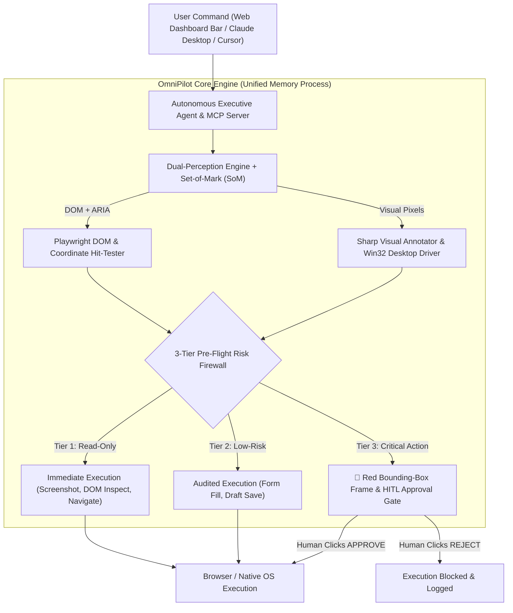

# 🚀 OmniPilot-MCP

> **Autonomous Cross-Platform Executive Agent & Pre-Execution Visual Firewall for Browser & Desktop Operations via Model Context Protocol (MCP)**  
> **Agente Esecutivo Autonomo Multipiattaforma & Firewall Visivo Pre-Esecuzione per Browser e Desktop tramite Model Context Protocol (MCP)**

[](https://github.com/GabriMannino-pt/OmniPilot-MCP/actions)
[](https://www.typescriptlang.org/)
[](https://nodejs.org/)
[](https://modelcontextprotocol.io/)
[](https://playwright.dev/)
[](https://vitejs.dev/)
[](LICENSE)

[**🇬🇧 English**](#-english-documentation) | [**🇮🇹 Documentazione Italiana**](#-documentazione-italiana)

---

# 🇬🇧 English Documentation

## 🌐 1. Executive Summary & Vision

While most AI automation scripts are fragile text wrappers or unguarded browser drivers, **OmniPilot-MCP** combines **Autonomous Goal Execution**, **Set-of-Mark (SoM) Dual-Perception**, and a **Deterministic Pre-Execution Visual Firewall** in a single unified Model Context Protocol (`2024-11-05`) server and bilingual Web Control Cockpit.

Give OmniPilot a high-level instruction in English or Italian — for example:
- *"Send a welcome email to mariorossi@gmail.com"* (`"Invia un'email di benvenuto a mariorossi@gmail.com"`)
- *"Extract approved ERP invoices and prepare the €24,500 wire transfer"*
- *"Clean up staging cache and delete obsolete production records"*

OmniPilot autonomously navigates the interface, perceives interactive elements via **Set-of-Mark `[1, 2, 3...]` tags**, executes safe steps (Tier 1 & Tier 2) at zero latency, and **physically intercepts irreversible actions (Tier 3)** before the click happens — drawing a **red bounding-box frame** around the exact target and waiting for your 1-click approval in the Live Web Dashboard.



---

## 🛡️ 2. Anti-Bypass Security Architecture (Red-Team Hardened)

Unlike prompt-based guardrails that an LLM can accidentally bypass, OmniPilot enforces **4 deterministic pre-execution inspection barriers**:

| Bypass Vector | How Standard Wrappers Fail | How OmniPilot-MCP Neutralizes It |
| :--- | :--- | :--- |
| **1. Coordinate Blindness** (`click_coordinate(x, y)`) | Clicking `(x, y)` bypasses CSS selector keyword checks completely. | **DOM Hit-Testing (`document.elementFromPoint(x, y)`)**: inspects the real DOM element, ancestor `<button>`, `aria-label`, and `innerText` under `(x, y)` *before* dispatching the mouse click. |
| **2. Selector Obfuscation** (`button.css-192x`) | Generic classes hide critical labels like `"Confirm Wire Transfer"`. | **Pre-Flight Live DOM Inspection**: queries the live element's visible text, `value`, and attributes before clicking. |
| **3. Implicit Enter Submit** (`type_text(..., pressEnter: true)`) | Pressing `Enter` inside an input submits a critical form without clicking the button. | **Form Submit Button Scanner**: inspects the parent `<form>`'s submit button text whenever `pressEnter: true` is requested. |
| **4. Scunthorpe False Positives** (`.border-box`, `#postal-code`) | Naive `.includes("order")` or `.includes("post")` blocks harmless layout classes. | **Token-Boundary Regex Engine**: splits camelCase, kebab-case, and snake_case into discrete tokens before matching critical verbs. |

---

## 🛠️ 3. MCP Tool Catalog (`tools/list` — 8 Tools)

| Tool Name | Risk Tier | Primary Parameters | Description |
| :--- | :---: | :--- | :--- |
| `omnipilot_navigate` | **Tier 1 (Safe)** | `url: string`, `waitUntil?: 'load' \| 'networkidle'` | Navigates the headless browser or attached CDP session to a target URL or `data:text/html` workspace. |
| `omnipilot_take_screenshot` | **Tier 1 (Safe)** | `target: 'browser' \| 'desktop'`, `annotateInteractive?: boolean` | Captures lossless PNG screenshot; optionally overlays **Set-of-Mark (`#1`, `#2`)** numbered badges on interactive elements. |
| `omnipilot_inspect_dom` | **Tier 1 (Safe)** | `selector?: string`, `includeAccessibility?: boolean` | Extracts semantic ARIA snapshot and interactive DOM elements with unique selectors, bounding boxes, and `markId` (`#1..#N`). |
| `omnipilot_click_element` | **Tier 2 / Tier 3** | `selector?: string`, `markId?: number` | Clicks an element by CSS selector or **Set-of-Mark ID (`markId`)** after running Pre-Flight DOM Risk Inspection. |
| `omnipilot_click_coordinate` | **Tier 2 / Tier 3** | `x: number`, `y: number`, `target?: 'browser' \| 'desktop'` | Runs `elementFromPoint(x, y)` hit-testing before clicking at `(x, y)` in Playwright or native Win32 `user32.dll`. |
| `omnipilot_type_text` | **Tier 2 / Tier 3** | `text: string`, `selector?: string`, `markId?: number`, `pressEnter?: boolean`, `isSecret?: boolean` | Fills inputs by selector or `markId`; masks secrets (`***REDACTED***`) and checks parent form submit buttons on `pressEnter`. |
| `omnipilot_request_approval` | **Tier 3 (Critical)** | `actionSummary: string`, `tier: 3`, `boundingBox?: Rect` | Suspends execution, generates a visual red bounding-box PNG frame, and awaits human confirmation in the Web Dashboard. |
| `omnipilot_execute_task` | **Autonomous (Tier 1→3)** | `goal: string`, `language?: 'it' \| 'en'`, `autoApproveTier3?: boolean` | Executes a multi-step natural language goal end-to-end with automatic Tier 3 interception and HITL confirmation. |

---

# 🇮🇹 Documentazione Italiana

## 🌐 1. Panoramica: Come funziona (Spiegato Semplice)

**OmniPilot-MCP** è un agente esecutivo autonomo dotato di **freno d'emergenza visivo** e pannello di controllo bilingue (**Italiano / Inglese**).

Tu gli scrivi un compito nella barra di comando (o tramite Claude Desktop / Cursor), ad esempio:
> **`Invia un'email di benvenuto a mariorossi@gmail.com`**

Ecco cosa fa il sistema passo dopo passo:
1. **Apre l'applicazione** (es. il client di posta OmniMail o il portale ERP aziendale).
2. **Osserva lo schermo con doppia vista (`Dual-Perception` + `Set-of-Mark`)**: scatta una foto reale dello schermo e numera tutti i pulsanti e campi di testo (`#1`, `#2`, `#3`...) con le loro coordinate esatte.
3. **Esegue da solo i passaggi sicuri (Tier 1 e Tier 2)**: scrive `mariorossi@gmail.com` nel campo destinatario, compila l'oggetto e il messaggio di benvenuto, e clicca su *"Salva Bozza"*.
4. **Si blocca prima dell'azione irreversibile (Tier 3)**: quando sta per cliccare su **`Invia Email Ora`**, il Firewall Pre-Esecuzione legge il testo reale del pulsante nel DOM, **mette in pausa l'agente**, disegna un **riquadro rosso lampeggiante** attorno al pulsante nella foto dello schermo e fa apparire il banner di approvazione nella Web Dashboard.
5. **Aspetta il tuo clic**: solo quando clicchi su **`APPROVA ESECUZIONE`** l'email viene effettivamente spedita e registrata nel registro di sicurezza (`Audit Log`). Se clicchi **`RIFIUTA`**, l'invio viene annullato.

---

## 🧩 2. Tutte le 16 Funzioni del Sistema

### 👁️ Gruppo 1: Percezione ("Gli Occhi")
1. **Screenshot Browser e Desktop (`VisionEngine`)**: cattura istantanee PNG reali dal browser Chromium o dal monitor del sistema operativo (`base64` o file `.png` su disco).
2. **Mappa Semantica + Set-of-Mark (`DomEngine`)**: estrae tutti gli elementi cliccabili, genera selettori CSS univoci e assegna a ciascuno una targhetta numerata (`markId: 1, 2, 3...`).
3. **Fusione Vista + Codice (`DualPerceptionEngine`)**: unisce l'immagine PNG e la lista dei pulsanti con le loro coordinate `(x, y, larghezza, altezza)`.
4. **Annotatore Visivo (`VisualAnnotator`)**: disegna targhette numerate blu (`#1`, `#2`) o un riquadro rosso di allarme sopra il pulsante critico prima del clic.

### 🦾 Gruppo 2: Azione ("Le Mani")
5. **Navigazione Web & CDP (`omnipilot_navigate`)**: apre URL esterni, applicazioni locali o si collega a un browser Chrome già aperto tramite `CDP_ENDPOINT`.
6. **Clic Intelligente per Selettore o Numero (`omnipilot_click_element`)**: clicca usando il selettore CSS oppure direttamente il numero Set-of-Mark (`markId: 3`).
7. **Clic a Coordinate Reali (`omnipilot_click_coordinate`)**: clicca a coordinate `(x, y)` nel browser o sposta fisicamente il cursore del mouse su Windows tramite API nativa Win32 (`user32.dll`).
8. **Scrittura Testo e Oscuramento Password (`omnipilot_type_text`)**: compila moduli e nasconde automaticamente eventuali password (`***REDACTED***`) nei registri.
9. **Esecutore Autonomo di Compiti (`omnipilot_execute_task`)**: riceve un obiettivo in linguaggio naturale (es. *"Invia un'email di benvenuto a mariorossi@gmail.com"*), pianifica i passi e li esegue in autonomia.

### 🛡️ Gruppo 3: Sicurezza ("Il Cervello di Controllo")
10. **Classificatore a 3 Livelli Anti-Bypass (`RiskEngine`)**:
    - **Tier 1 (Sicuro):** sola lettura (screenshot, ispezione DOM).
    - **Tier 2 (Basso Rischio):** compilazione bozze, clic di navigazione reversibili.
    - **Tier 3 (Critico / Irreversibile):** invio email, bonifici/pagamenti, cancellazione dati, inserimento password.
11. **Ispezione Pre-Flight DOM & Coordinate Hit-Testing**: controlla cosa c'è davvero scritto sul pulsante o sotto le coordinate `(x, y)` prima di cliccare, impedendo aggiramenti e falsi positivi.
12. **Lucchetto Umano (`ApprovalGate`)**: congela l'esecuzione delle azioni Tier 3 finché l'operatore umano non clicca Approva o Rifiuta.
13. **Scatola Nera (`AuditLog` + Network Monitor)**: registra ogni azione, chi l'ha approvata e traccia tutte le chiamate di rete mutative (`POST`, `PUT`, `DELETE`, `PATCH`).

### 🖥️ Gruppo 4: Cabina di Regia ("Il Cruscotto Bilingue IT/EN")
14. **Barra di Comando Diretto (`TaskCommandBar`)**: scrivi il compito che vuoi far eseguire all'agente o scegli un comando rapido con 1 clic, seguendo la timeline dei passaggi in tempo reale.
15. **Web Dashboard Interattiva (`React 19 + Vite`)**: mostra lo schermo live con i riquadri colorati, il selettore lingua `🇮🇹 IT | 🇬🇧 EN`, il popup rosso di approvazione con lo screenshot annotato e la tabella dell'Audit Log.
16. **Server MCP Unificato (`OmniPilotMcpServer`)**: espone gli 8 strumenti, le risorse (`omnipilot://status`, `omnipilot://audit-log`) e i prompt a Claude Desktop, Cursor o qualsiasi client MCP condividendo la stessa memoria della Web Dashboard.

---

## 🚀 3. Quickstart & Avvio Rapido (EN / IT)

### Prerequisites / Prerequisiti
- **Node.js:** `>= 20.0.0`
- **npm:** `>= 10.0.0`

### Installation / Installazione

```bash
git clone https://github.com/GabriMannino-pt/OmniPilot-MCP.git
cd OmniPilot-MCP
npm install
npx playwright install chromium
```

### 1. Start the Live Bilingual Web Control Dashboard / Avvia la Web Dashboard

```bash
# Build frontend & start server on http://localhost:3000
npm run dashboard
```

Open **`http://localhost:3000`** in your browser:
- Switch between **🇮🇹 IT** and **🇬🇧 EN** in the top header.
- Type **`Invia un'email di benvenuto a mariorossi@gmail.com`** (or click the preset button) and press **Esegui Compito / Execute Task**.
- Watch the agent fill the email fields, intercept the Send button with a **red bounding box**, and wait for your click on **APPROVA ESECUZIONE / APPROVE EXECUTION**.

### 2. Run the Automated Test Suite (38 Unit, E2E & Red-Team Tests)

```bash
# Compile TypeScript (Strict Mode)
npm run build

# Run all 38 tests (including the 4 Red-Team anti-bypass security tests)
npm test

# Run the E2E Procurement & Guarded Wire Transfer Demo
npm run demo

# Run the Dual-Perception CLI Diagnostics
npm run cli
```

### 3. Connect to Claude Desktop / Cursor (`claude_desktop_config.json`)

When launched via MCP Stdio, OmniPilot also starts the unified Web Dashboard on `http://localhost:3000` in the same process so you can visually approve Tier 3 actions triggered by Claude or Cursor:

```json
{
  "mcpServers": {
    "omnipilot": {
      "command": "node",
      "args": ["D:/omnipilot-mcp/dist/index.js"],
      "env": {
        "DASHBOARD_PORT": "3000"
      }
    }
  }
}
```

---

## 📂 4. Repository Layout / Struttura del Progetto

```text
d:/omnipilot-mcp/
├── .github/workflows/ci.yml         # GitHub Actions CI/CD (Playwright + Vitest + Build)
├── docker/                          # Multi-stage Docker packaging with Chromium
│   ├── Dockerfile
│   └── docker-compose.yml
├── src/
│   ├── agent/
│   │   └── agentRunner.ts           # Autonomous Executive Agent (IT/EN NL goals)
│   ├── mcp/
│   │   ├── mcpServer.ts             # Core JSON-RPC 2.0 MCP Server (Unified Process)
│   │   ├── schemas.ts               # Zod validation schemas for all 8 MCP tools
│   │   └── handlers/                # Tools, Resources, Prompts handlers
│   ├── perception/
│   │   ├── domEngine.ts             # ARIA snapshot + Set-of-Mark (SoM) parser
│   │   ├── visionEngine.ts          # Browser & Desktop PNG capture engine
│   │   ├── visualAnnotator.ts       # Sharp SVG red bounding-box & SoM badge overlay
│   │   └── dualPerception.ts        # Hybrid DOM + Vision coordinator
│   ├── execution/
│   │   ├── browserDriver.ts         # Playwright Chromium + CDP + DOM Hit-Testing
│   │   └── desktopDriver.ts         # Native Win32 (user32.dll) cursor & screen driver
│   ├── safety/
│   │   ├── riskEngine.ts            # Token-boundary 3-Tier Pre-Flight Risk Firewall
│   │   └── approvalGate.ts          # Event-driven HITL guardrail & audit trail
│   ├── server/
│   │   ├── dashboardApi.ts          # REST API & Static server for Web Cockpit
│   │   └── startDashboard.ts        # Standalone Dashboard launcher
│   ├── scenarios/
│   │   └── procurementScenario.ts   # E2E ERP invoice & guarded wire transfer demo
│   ├── cli.ts                       # CLI Dual-Perception diagnostics
│   └── index.ts                     # Unified MCP Stdio + Web Dashboard entrypoint
├── web-dashboard/                   # Bilingual (IT/EN) React 19 + Vite Cockpit
│   └── src/
│       ├── components/
│       │   ├── Header.tsx           # Status badges & IT/EN language switcher
│       │   ├── TaskCommandBar.tsx   # Natural language task bar & live step timeline
│       │   ├── LiveCanvas.tsx       # Live visual canvas with bounding boxes
│       │   ├── ApprovalGateModal.tsx# Interactive HITL modal with red-box screenshot
│       │   └── AuditLogView.tsx     # Real-time structured audit trail
│       ├── i18n.ts                  # Complete Italian & English translations
│       └── App.tsx
├── tests/
│   ├── unit/                        # RiskEngine, ApprovalGate, MCP, Dashboard, Red-Team
│   └── e2e/                         # Complete E2E procurement scenario test
└── package.json
```

---

## 👤 Author & License

* **Architect & Developer:** Gabriele Mannino
* **Repository:** [https://github.com/GabriMannino-pt/OmniPilot-MCP](https://github.com/GabriMannino-pt/OmniPilot-MCP)
* **License:** MIT License
