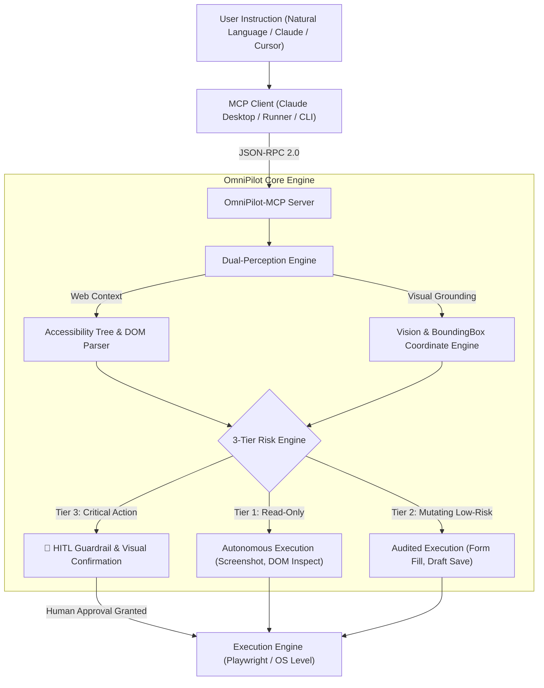
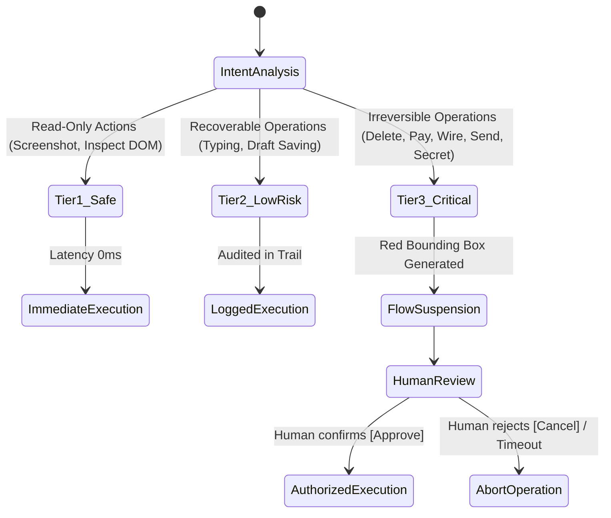

# 🚀 OmniPilot-MCP

> **Autonomous Cross-Platform Executive Agent for Browser & Desktop Operations via Model Context Protocol (MCP)**

[](https://github.com/GabriMannino-pt/OmniPilot-MCP/actions)
[](https://www.typescriptlang.org/)
[](https://nodejs.org/)
[](https://modelcontextprotocol.io/)
[](https://playwright.dev/)
[](https://vitejs.dev/)
[](LICENSE)

---

## 🌐 1. Executive Summary & Vision

While 95% of AI automation solutions are basic text wrappers or fragile RAG bots, **OmniPilot-MCP** represents the frontier of **Computer-Use and Cross-Platform GUI Execution** — the same paradigm pioneered by Anthropic Computer Use and Google Project Jarvis.

OmniPilot-MCP translates complex natural language instructions (*"Extract supplier invoices, fill the internal ERP payment draft, and prepare the wire transfer"*) into deterministic actions across web and desktop canvases.

It implements:
1. **👁️ Dual-Perception Engine:** Fuses visual pixels (lossless screenshotting with coordinate bounding boxes) with semantic accessibility trees (`page.locator().ariaSnapshot()`).
2. **🛡️ 3-Tier Risk Engine:** Pre-execution safety classifier guarding against accidental data deletion, unauthorized payments, or unintended communications.
3. **🛑 Human-in-the-Loop (HITL) Guardrail:** Generates visual alert overlays with red bounding boxes on target buttons, suspending execution until human approval is confirmed.
4. **⚡ Standard MCP Protocol (`2024-11-05`):** Native JSON-RPC 2.0 interoperability for Claude Desktop, Cursor, and any MCP client.



---

## 📊 2. Architectural Comparison Matrix

| Capability | Standard Selenium / Playwright Wrappers | Anthropic Computer Use (Raw) | **OmniPilot-MCP** |
| :--- | :---: | :---: | :---: |
| **Protocol Standardization** | ❌ Proprietary APIs | ❌ Anthropic API only | ✅ **Standard Model Context Protocol (`2024-11-05`)** |
| **Dual Perception (Vision + ARIA)** | ❌ DOM-only | ❌ Vision-only (coordinates) | ✅ **Hybrid Dual-Perception (DOM + Vision Grounding)** |
| **Safety Engine & Risk Tiers** | ❌ None | ❌ Prompt-only guardrails | ✅ **Deterministic 3-Tier Pre-Execution Engine** |
| **Visual Human-in-the-Loop (HITL)** | ❌ No | ❌ Terminal only | ✅ **Automated Red Bounding Box Frame + Approval Modal** |
| **Audit Trail & Compliance** | ❌ Fragmented logs | ❌ Unstructured | ✅ **Tamper-Evident Structured JSON Audit Trail** |
| **Real-time Web Cockpit** | ❌ No | ❌ No | ✅ **React 19 + Vite Live Control Dashboard** |

---

## 🛠️ 3. MCP Tool Catalog (`tools/list`)

OmniPilot-MCP exposes 6 standardized tools through the Model Context Protocol:

| Tool Name | Risk Tier | Primary Input Parameters | Description |
| :--- | :---: | :--- | :--- |
| `omnipilot_take_screenshot` | **Tier 1 (Safe)** | `target: 'browser' \| 'desktop'`, `format: 'base64'` | Captures active display or headless browser canvas with reference metadata. |
| `omnipilot_inspect_dom` | **Tier 1 (Safe)** | `selector?: string`, `includeAccessibility: boolean` | Extracts semantic ARIA accessibility tree and interactive DOM elements with bounding boxes. |
| `omnipilot_click_element` | **Tier 2 / Tier 3** | `selector: string`, `waitForNavigation?: boolean` | Deterministically clicks DOM elements; escalates to Tier 3 if selector matches critical operations. |
| `omnipilot_click_coordinate` | **Tier 2 (Low Risk)** | `x: number`, `y: number`, `button?: 'left' \| 'right'` | Dispatches hardware-level cursor clicks at canvas/screen XY coordinates. |
| `omnipilot_type_text` | **Tier 2 / Tier 3** | `text: string`, `selector?: string`, `isSecret?: boolean` | Types keystrokes or fills form controls; masks credentials and escalates to Tier 3 when `isSecret: true`. |
| `omnipilot_request_approval` | **Tier 3 (Critical)** | `actionSummary: string`, `tier: 3`, `boundingBox?: Rect` | **HITL Guardrail:** Suspends execution, generates annotated visual frame, and awaits human authorization. |

---

## 🔒 4. 3-Tier Safety Engine (Tiered Risk Engine)

Every incoming action is analyzed before execution:



- **Tier 1 (Safe - Read Only):** Zero side-effects. Execution occurs immediately at zero latency.
- **Tier 2 (Low Risk - Recoverable):** Internal navigation and non-critical form filling. Execution is traced in the audit log.
- **Tier 3 (Critical - Irreversible):** Financial transactions, deletions, external dispatches, or password entries. The agent pauses, highlights the target button visually, and waits for confirmation.

---

## 🚀 5. Quickstart & Usage

### Prerequisites
- **Node.js:** `>= 20.0.0`
- **npm:** `>= 10.0.0`

### Installation

```bash
git clone https://github.com/GabriMannino-pt/OmniPilot-MCP.git
cd OmniPilot-MCP
npm install
```

### Running Test Suite & Demos

```bash
# Compile TypeScript (Strict Mode)
npm run build

# Run complete Vitest suite (32 unit & E2E tests)
npm test

# Run Procurement & Guarded Email Dispatch E2E Demo
npm run demo

# Run Dual-Perception CLI Diagnostics Showcase
npm run cli
```

### Running the Web Control Dashboard

```bash
# Start the live dashboard on http://localhost:3000
npm run dashboard
```

Open `http://localhost:3000` to access the real-time visual canvas, interactive bounding box highlights, and the HITL approval cockpit.

### Connecting to Claude Desktop

Add OmniPilot-MCP to your `claude_desktop_config.json`:

```json
{
  "mcpServers": {
    "omnipilot": {
      "command": "node",
      "args": ["D:/omnipilot-mcp/dist/index.js"]
    }
  }
}
```

---

## 📂 6. Repository Layout

```text
d:/omnipilot-mcp/
├── .github/workflows/ci.yml         # GitHub Actions CI/CD Pipeline
├── docker/                          # Multi-stage Docker packaging
│   ├── Dockerfile
│   └── docker-compose.yml
├── src/
│   ├── mcp/
│   │   ├── mcpServer.ts             # Core JSON-RPC 2.0 MCP Server
│   │   ├── schemas.ts               # Zod validation contracts
│   │   └── handlers/                # Tools, Resources, Prompts handlers
│   ├── perception/
│   │   ├── domEngine.ts             # Semantic ARIA accessibility parser
│   │   ├── visionEngine.ts          # Screenshot capture & coordinate mapper
│   │   ├── visualAnnotator.ts       # Sharp-powered SVG bounding box overlay
│   │   └── dualPerception.ts        # Hybrid DOM + Vision coordinator
│   ├── execution/
│   │   ├── browserDriver.ts         # Playwright Chromium headless driver
│   │   └── desktopDriver.ts         # OS-level display & mouse coordinator
│   ├── safety/
│   │   ├── riskEngine.ts            # Deterministic 3-Tier risk classifier
│   │   └── approvalGate.ts          # Event-driven HITL guardrail & audit trail
│   ├── server/
│   │   ├── dashboardApi.ts          # REST/Static server for Web Cockpit
│   │   └── startDashboard.ts        # Dashboard launcher entrypoint
│   ├── scenarios/
│   │   └── procurementScenario.ts   # E2E ERP invoice & email draft scenario
│   ├── cli.ts                       # CLI diagnostics runner
│   └── index.ts                     # MCP Stdio entrypoint
├── web-dashboard/                   # React 19 + Vite Web Control Dashboard
│   ├── src/
│   │   ├── components/
│   │   │   ├── Header.tsx           # Status and controls header
│   │   │   ├── LiveCanvas.tsx       # Live visual canvas with bounding boxes
│   │   │   ├── ApprovalGateModal.tsx# Interactive HITL approval modal
│   │   │   └── AuditLogView.tsx     # Structured audit trail view
│   │   └── App.tsx
│   ├── package.json
│   └── vite.config.ts
├── tests/
│   ├── unit/                        # Risk Engine, Gate, MCP Server, Dashboard tests
│   └── e2e/                         # Complete procurement scenario test
├── package.json
├── tsconfig.json
└── BLUEPRINT.md                     # Original architectural specification
```

---

## 🏆 7. Implementation Roadmap Status

| Phase | Milestone | Status |
| :--- | :--- | :---: |
| **Fase 1** | Scaffolding, TypeScript Strict, MCP SDK 2024-11-05, Core Server | ✅ **COMPLETED** |
| **Fase 2** | Dual-Perception Engine, Playwright Chromium, ARIA Snapshot, Sharp Visual Grounding | ✅ **COMPLETED** |
| **Fase 3** | Deterministic 3-Tier Risk Engine, HITL Event Gatekeeper, Audit Log Engine | ✅ **COMPLETED** |
| **Fase 4** | E2E Procurement Demo, Autonomous Report Extraction, Guarded Wire Transfer | ✅ **COMPLETED** |
| **Fase 5** | Web Control Dashboard (React 19 + Vite), Live Canvas, HITL Modal | ✅ **COMPLETED** |
| **Fase 6** | Architecture Documentation, Showcase Benchmark, Release Tag v0.1.0 | ✅ **COMPLETED** |

---

## 👤 Author & Architecture

* **Architect & Developer:** Gabriele Mannino
* **Repository:** [https://github.com/GabriMannino-pt/OmniPilot-MCP](https://github.com/GabriMannino-pt/OmniPilot-MCP)
* **License:** MIT License
